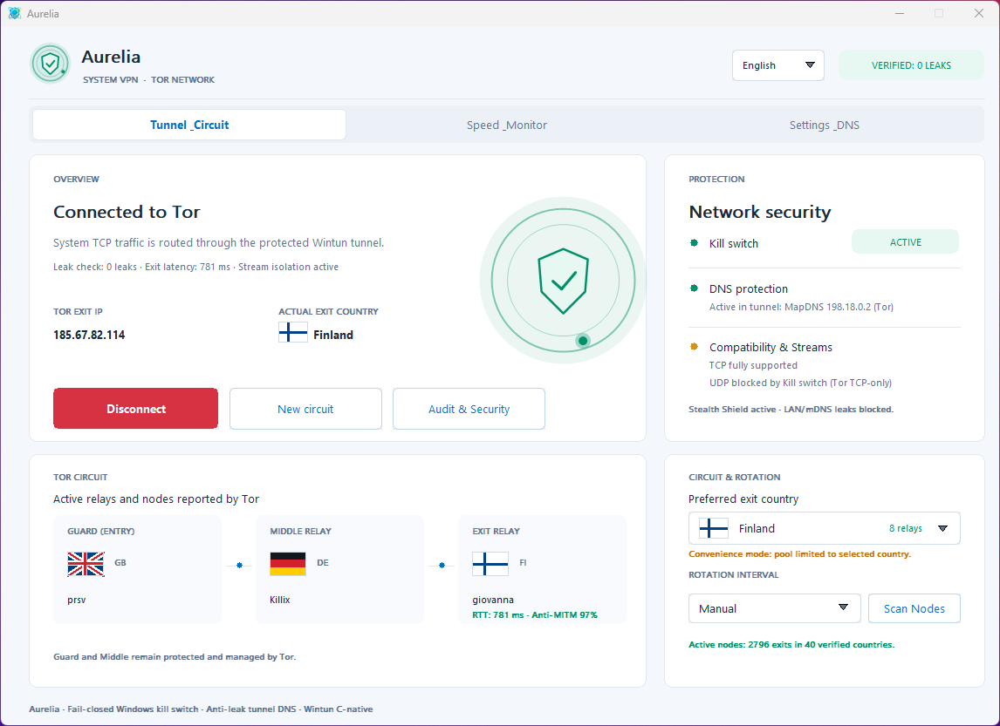

<div align="center">

# Aurelia

### High-Performance Kernel-Level Tor VPN for Windows

**System-Wide Anonymous Tunneling · Wintun Layer-3 Adapter · Fail-Closed WFP Engine · Zero DNS Leaks**

[](https://github.com/mzguardit/aurelia)
[](https://github.com/mzguardit/aurelia)
[-10B981?style=flat-square)](https://www.wintun.net/)
[](https://learn.microsoft.com/en-us/windows/win32/fwp/windows-filtering-platform-start-page)
[](https://www.torproject.org/)
[](LICENSE)
[](https://github.com/mzguardit/aurelia/releases/tag/v1.1.0)
[](https://github.com/mzguardit/aurelia)
[](https://github.com/mzguardit/aurelia)

<br/>



</div>

---

## Executive Summary

Traditional Tor usage on Windows is typically confined to the Tor Browser application boundary. Attempts to "torify" an entire Windows operating system usually rely on user-space SOCKS proxies or fragile routing table hacks that suffer from critical vulnerabilities:
1. **DNS Leaks**: Applications resolving domains directly against local ISP gateways or IPv6 endpoints.
2. **Correlation Risks**: All applications sharing identical circuits and exit nodes.
3. **Fail-Open Windows**: Network roaming, DHCP renewals, or Tor crashes exposing real IP addresses before rules can react.
4. **I/O Degradation**: Tor constantly reading and writing consensus documents to solid-state disks.

**Aurelia** resolves these structural limitations through a native C11 architecture integrating WireGuard's **Wintun** Layer-3 virtual TUN adapter, strict **Windows Filtering Platform (WFP)** kernel callouts, internal **MapDNS** resolution, and a memory-backed consensus pipeline.

---

## Architecture & Data Flow

```text
+---------------------------------------------------------------------------------------+
|                                    WINDOWS USER-SPACE                                 |
|                                                                                       |
|   +-------------------+   +--------------------+   +------------------------------+   |
|   | Standard Browsers |   | Terminal & Scripts |   | Security Audit (Burp / ZAP)  |   |
|   +---------+---------+   +---------+----------+   +--------------+---------------+   |
|             |                       |                             |                   |
|             | IP Traffic            | IP Traffic                  | Upstream SOCKS5   |
|             v                       v                             v (127.0.0.1:9052)  |
|   +--------------------------------------------+                  |                   |
|   |        Wintun Virtual Adapter (L3)         |                  |                   |
|   |         IPv4: 198.18.0.1 / MTU 1500        |                  |                   |
|   +---------------------+----------------------+                  |                   |
|                         |                                         |                   |
|                         v                                         |                   |
|   +--------------------------------------------+                  |                   |
|   |      hev-socks5-tunnel Core Engine         |                  |                   |
|   |   - Async lwIP TCP Stack                   |                  |                   |
|   |   - MapDNS Server (198.18.0.2:53)          |                  |                   |
|   +---------------------+----------------------+                  |                   |
|                         | SOCKS5 Loopback                         |                   |
|                         v                                         |                   |
|   +---------------------------------------------------------------+---------------+   |
|   |                         Tor Embedded Core (tor.exe)                           |   |
|   |     - SOCKS5 Proxy (127.0.0.1:9050)    - Auxiliary Pentest Port (9052)        |   |
|   |     - AvoidDiskWrites 1 (RAM Cache)    - Pluggable Transports (Lyrebird)      |   |
+---+-------------------------------------------------------------------------------+---+
|                                  KERNEL BOUNDARY                                      |
|                                                                                       |
|   +-------------------------------------------------------------------------------+   |
|   |                     Windows Filtering Platform (WFP Engine)                   |   |
|   |   - Sublayer Priority Weight: 15 (Fail-Closed Enforcement)                    |   |
|   |   - Permit: Localhost Loopback (Tor Control & SOCKS5)                         |   |
|   |   - Permit: Outbound Tor Process Traffic to Entry Relays                      |   |
|   |   - Block: ALL non-tunneled IPv4/IPv6 traffic                                  |   |
|   |   - Block: ALL unmapped UDP/QUIC (forcing graceful TCP fallback)              |   |
+---+---------------------------------------+---------------------------------------+---+
                                            |
                                            v Encrypted TLS Packets
                                  [ INTERNET GATEWAY ]
                                            |
                                            v
                         +-------------------------------------+
                         |      TOR THREE-HOP CIRCUIT          |
                         |  [Guard] -> [Middle] -> [Exit Node] |
                         +------------------+------------------+
                                            |
                                            v Plaintext / TLS Target
                                  [ TARGET WEB DESTINATION ]
```

---

## Technical Comparison Matrix

| Architectural Feature | Aurelia System VPN | Tor Browser | Commercial VPNs | Generic SOCKS5 |
| :--- | :---: | :---: | :---: | :---: |
| **System-Wide Traffic Capture** | Full (L3 Wintun) | Browser Only | Full (L3 TUN) | App-Specific |
| **Fail-Closed Pre-Boot Kill Switch** | Native WFP (Kernel) | Not Applicable | Proprietary Driver | None |
| **Zero-Leak DNS & Fake-IP Engine** | Synthetic 198.18.0.0/15 | Internal SOCKS | Provider DNS | Vulnerable |
| **Universal .onion Support for All Apps** | Transparent Native | Browser Only | None | Manual Proxy |
| **Aurelia Turbo Boost (Multi-Guard)** | 6 Guards + FastFirstHop | Standard 1-3 | Not Applicable | Not Applicable |
| **Windows Stealth Shield (Anti-LAN Leak)** | WFP mDNS/LLMNR/SSDP Drop | Not Applicable | Rare | None |
| **Dynamic Stream Isolation** | Distinct Circuit / Target | Tab-level | Single Tunnel IP | None |
| **Traffic Anonymity** | Multi-Hop Tor Network | Multi-Hop Tor | Single Provider IP | Single Node |
| **Flash / SSD Wear Protection** | RAM Only (`AvoidDiskWrites`) | Disk Cached | Not Applicable | Not Applicable |
| **Kernel Ring Buffer Capacity** | 4 MB Lock-Free | Not Applicable | Varies | None |
| **Dedicated Pentest Auxiliary Port** | Yes (`127.0.0.1:9052`) | No | No | Optional |
| **Active Exit Node Verification** | Real-Time Anti-MITM | Manual | Not Applicable | None |
| **Built-in Pluggable Transports** | Snowflake / Lyrebird | Built-in | Proprietary | None |
| **Copyleft Licensing Guarantee** | GNU AGPL-3.0 | MPL / BSD | Closed Source | Varies |

---

## Core Engineering Pillars

### 1. Fail-Closed Windows Filtering Platform (WFP) & Stealth Shield
Aurelia does not rely on routing table priority alone. At connection time, Aurelia injects persistent filters into the Windows Filtering Platform at the kernel sublayer:
- **Default Drop**: An absolute block rule is registered for all outbound IPv4 and IPv6 traffic.
- **Windows Stealth Shield**: Completely suppresses local background Windows broadcasts including mDNS (UDP 5353), LLMNR (UDP 5355), NetBIOS Name Service (UDP 137, 138, TCP 139), and SSDP (UDP 1900), eliminating local network fingerprinting.
- **Selective Whitelist**: Only packets generated by `tor.exe` destined for validated entry guards and internal loopback (`127.0.0.1`) are permitted.
- **Fail-Closed Safety**: In the event of a software crash, cable disconnection, or Wi-Fi roaming event, no unencrypted frame can escape the host machine.

### 2. Synthetic Fake-IP Engine (198.18.0.0/15) & Universal .onion Routing
To eliminate DNS query latency and guarantee zero-knowledge privacy, Aurelia features a synthetic Fake-IP mapping engine allocating from a massive 131,072-address CIDR block (`198.18.0.0/15`):
- **Zero Latency DNS**: DNS queries receive an instant 0 ms response directly from the local kernel-side tunnel, avoiding round-trip DNS lookups over the Tor circuit before TCP syn.
- **System-Wide .onion Routing**: Windows applications (terminals, command prompt, SSH clients, Git, cURL, web browsers) can connect directly to `.onion` hidden services without proxy wrappers.
- **16K LRU In-Memory Cache**: High-density translation table prevents address collisions and keeps DNS resolution strictly in RAM.

### 3. Aurelia Turbo Boost & Multi-Guard Speed Acceleration
Tor connection overhead is dramatically minimized through custom circuit pipeline tuning:
- **Expanded Guard Pool (`NumEntryGuards 6`)**: Widens the entry guard pool from 3 to 6 high-bandwidth verified relays, eliminating bottlenecks caused by slow single entry nodes.
- **Fast First-Hop Public Key (`FastFirstHopPK 1`)**: Reduces cryptographic CPU cycles and round trips during the initial onion handshake with the guard node.
- **Aggressive Circuit Building (`CircuitBuildTimeout 4`)**: Automatically drops slow circuit paths taking longer than 4 seconds, guaranteeing responsive connection establishment.

### 4. Dynamic Stream Isolation
When multiple applications or background services connect simultaneously, Aurelia prevents cross-session correlation:
- Uses `IsolateDestAddr`, `IsolateDestPort`, and `KeepAliveIsolateSOCKSAuth`.
- Each unique destination host and port is routed through a separate 3-hop Tor circuit with distinct guard, middle, and exit relays.

### 5. High-Throughput Wintun Layer-3 Adapter
Rather than using outdated TAP adapters, Aurelia utilizes WireGuard's **Wintun** driver:
- Operates directly inside the Windows Network Driver Interface Specification (NDIS).
- Employs a 4 MB high-speed circular ring buffer with zero-copy packet exchange between user-space and kernel memory.
- Provides consistent throughput and low latency for concurrent TCP streams.

### 6. RAM Consensus & SSD Protection
Tor's consensus document and microdescriptors undergo frequent write cycles that induce wear on solid-state drives. Aurelia forces:
```text
AvoidDiskWrites 1
```
All relay descriptor directories, consensus verification files, and ephemeral state tables are stored purely in volatile memory, reducing disk I/O to zero and enhancing operational security against physical disk acquisition.

### 7. Security Audit & Upstream Integration
Aurelia includes an auxiliary SOCKS5 proxy port (**`127.0.0.1:9052`**) operating concurrently with the transparent tunnel:
- Easily configured as the upstream proxy in **Burp Suite Professional**, **OWASP ZAP**, or custom offensive tooling.
- Rotate IP addresses on demand with instant new identity generation via the management interface.

---

## Downloads & Quick Start

### Windows Setup Installer
Recommended for standard workstations:
- **[Aurelia-Setup-v1.1.0.exe](https://github.com/mzguardit/aurelia/releases/download/v1.1.0/Aurelia-Setup-v1.1.0.exe)**
  - Fully self-contained installer (includes Tor core, Wintun driver, and pluggable transports).
  - Automatically establishes desktop and start menu shortcuts with administrative UAC manifest.
  - Pre-configures directory access control lists (ACLs) to eliminate permission faults.

### Portable Standalone Archive
Recommended for portable security toolkits:
- **[Aurelia-v1.1.0-Portable.zip](https://github.com/mzguardit/aurelia/releases/download/v1.1.0/Aurelia-v1.1.0-Portable.zip)**
  - Unpack to any directory and execute `aurelia.exe` with Administrator elevation.
  - Zero system registry pollution.

---

## Building from Source

### Requirements
- Windows 10 or 11 (64-bit)
- Microsoft Visual Studio 2022 (with Desktop development with C++)
- CMake 3.20 or newer
- Inno Setup 6.7+ (optional, for installer generation)

### Compilation

```powershell
# Clone the repository
git clone https://github.com/mzguardit/aurelia.git
cd aurelia

# Configure CMake
cmake -B build -S .

# Build optimized release binaries
cmake --build build --config Release
```

All compiled binaries will be placed in `build/Release/`.

To compile the installer package:
```powershell
& "C:\Program Files\Inno Setup 6\iscc.exe" installer/aurelia.iss
```

---

## Leak Verification Methodology

To verify that the system is completely leak-free under Aurelia:

1. **DNS Leak Testing**:
   Query extended test suites (e.g., `dnsleaktest.com`). The only reported servers will be Tor exit node resolvers.
2. **IPv6 Blackhole Verification**:
   Execute `curl -6 https://ifconfig.co`. Connections are blocked by the WFP engine, preventing dual-stack bypasses.
3. **Fail-Closed Test**:
   Terminate the `tor.exe` process intentionally via Task Manager. All network connectivity across all applications immediately ceases until the tunnel is re-established.

---

## License & Anti-Copyleft Protection

Aurelia is published under the **GNU Affero General Public License v3.0 (AGPL-3.0)**.

- **Strict Copyleft Protection**: It is legally prohibited to incorporate Aurelia or its components into closed-source commercial software, proprietary appliances, or closed white-label products.
- **Reciprocal Distribution**: Any modifications or network-accessible implementations must release complete source code under the identical AGPLv3 license terms.

See the complete legal text in [LICENSE](LICENSE).

---

## Sintesi in Italiano

Aurelia è un client VPN per Windows nativo in C11 progettato per instradare l'intero stack di rete di sistema attraverso la rete Tor tramite il driver kernel **Wintun** e regole firewall **WFP (Windows Filtering Platform)** fail-closed.

- **Motore Fake-IP 198.18.0.0/15**: Risoluzione DNS istantanea (0 ms) e routing trasparente dei domini `.onion` per qualsiasi processo Windows (browser, terminali, cURL, client SSH).
- **Aurelia Turbo Boost**: Pool esteso a 6 Guard, handshake rapido `FastFirstHopPK`, timeout circuito a 4s e cache LRU a 16.384 entry per massime prestazioni di navigazione.
- **Windows Stealth Shield**: Soppressione a livello firewall WFP di traffico mDNS (5353), LLMNR (5355), NetBIOS (137-139) e SSDP (1900) per impedire il fingerprinting su reti LAN.
- **Isolamento Stream Dinamico**: Circuiti Tor distinti a 3 hop per ciascuna destinazione e porta, impedendo la correlazione incrociata del traffico.
- **Protezione Kill Switch WFP Fail-Closed**: Blocco a livello kernel di qualsiasi pacchetto IPv4/IPv6 non instradato.
- **Nessuna usura disco**: Stato del consenso conservato puramente in RAM (`AvoidDiskWrites`).
- **Supporto Pentest**: Porta ausiliaria SOCKS5 su 127.0.0.1:9052 per Burp Suite, OWASP ZAP e strumenti di sicurezza.
