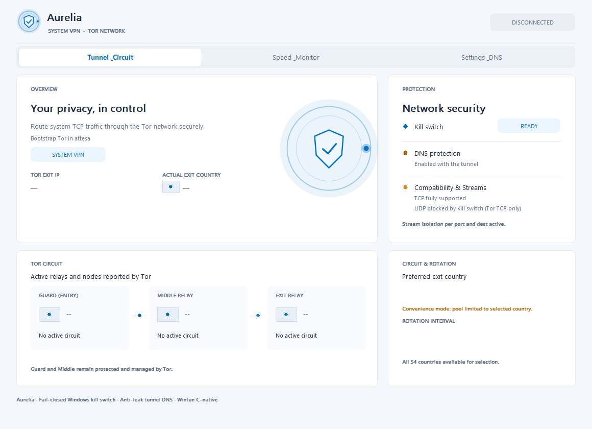

<div align="center">

# Aurelia · System VPN & Tor Network Client

**High-Performance, Zero-Leak System-Wide Tor VPN for Windows 10 & 11**

[](https://github.com/mzguardit/aurelia)
[](https://github.com/mzguardit/aurelia)
[](https://www.wintun.net/)
[](https://learn.microsoft.com/en-us/windows/win32/fwp/windows-filtering-platform-start-page)
[](https://www.torproject.org/)
[](LICENSE)

<br/>



</div>

---

## Overview

**Aurelia** is a native Windows system-wide Tor VPN client engineered in modern C11. Unlike browser-only proxies or fragile torification scripts, Aurelia establishes a genuine Layer 3 TUN virtual adapter via the high-throughput **Wintun** kernel driver and enforces strict **Windows Filtering Platform (WFP)** packet filtering.

Every application on your machine — browsers, terminal sessions, background services, security audit utilities — is seamlessly and securely tunneled through the Tor network with verifiable fail-closed leak prevention.

---

## Key Features & Architecture

### 1. Fail-Closed WFP Kill Switch & Pre-Boot Defense
- Native integration with the Windows Filtering Platform (WFP).
- Any packet attempting to exit outside the Wintun adapter is dropped at the kernel boundary.
- **Pre-Boot & Roaming Safety**: Firewall rules remain armed across Wi-Fi reconnection, DHCP lease renewal, network adapter drops, and sleep/resume cycles.

### 2. Anti-Leak DNS Tunneling (MapDNS)
- Traditional Tor tunnels on Windows often suffer from DNS queries leaking to local ISP resolvers or IPv6 interfaces.
- Aurelia captures all UDP/TCP DNS requests and routes them directly inside the tunnel to **MapDNS (198.18.0.2)**, ensuring zero external DNS leakage.
- Configurable DNS profiles: Tor MapDNS, Cloudflare Privacy DNS over Tor (1.1.1.1), Quad9 Malware-Blocking over Tor (9.9.9.9), or custom resolvers.

### 3. Real-Time Relay Circuit & Anti-MITM Verification
- Live visualization of the active 3-hop circuit: Guard (Entry) Relay, Middle Relay, and Exit Relay.
- Real-time round-trip latency (RTT) tracking.
- Exit country detection: reveals the actual public exit node IP and geographical origin, avoiding geolocation correlation pitfalls.

### 4. High-Throughput Wintun Driver & RAM Consensus Mode
- Built directly on WireGuard's battle-tested Wintun driver with a 4 MB high-speed kernel ring buffer.
- **SSD Protection Mode (AvoidDiskWrites)**: Keeps Tor directory consensus and microdescriptors entirely in volatile memory (RAM), eliminating flash storage wear and reducing I/O latency.
- Async IP packet streaming pipeline for smooth web browsing and terminal responsiveness.

### 5. Pentesting & Developer Upstream Port
- Aurelia includes a dedicated auxiliary SOCKS5 proxy port (**127.0.0.1:9052**) designed as an upstream proxy for security assessment tools (Burp Suite, OWASP ZAP, curl, custom Python scripts).
- One-click circuit renewal to rotate exit nodes on demand.

### 6. Pluggable Transports Ready
- Bundled censorship-circumvention transports:
  - Lyrebird (obfs4)
  - Snowflake
  - WebTunnel
  - Conjure

---

## Downloads & Installation

### Option 1: Windows Installer (Recommended)
Download and run the official setup:
- **[Download Aurelia-Setup-v1.0.0.exe](https://github.com/mzguardit/aurelia/releases/download/v1.0.0/Aurelia-Setup-v1.0.0.exe)**
  - Self-contained (includes Tor core, Wintun, and all transports).
  - Automatically configures Start Menu and Desktop shortcuts.
  - Includes a clean Control Panel uninstaller.

### Option 2: Portable Zip
- **[Download Release.zip](https://github.com/mzguardit/aurelia/releases/download/v1.0.0/Release.zip)**
  - Extract anywhere and run `aurelia.exe` as Administrator. Zero installation required.

> **Note**: Administrator privileges are required exclusively to initialize the Wintun kernel driver and arm the WFP firewall kill switch.

---

## Building from Source

### Prerequisites
- Windows 10 or 11 (64-bit)
- Visual Studio 2022 / Build Tools with C/C++ workload
- CMake 3.20 or newer

### Build Instructions

```powershell
# Clone the repository
git clone https://github.com/mzguardit/aurelia.git
cd aurelia

# Configure build directory
cmake -B build -S .

# Compile optimized Release binary
cmake --build build --config Release
```

All compiled binaries (`aurelia.exe`, `aurelia-net.exe`, `wintun.dll`, `hev-socks5-tunnel.dll`, and `Tor/`) will be generated inside `build/Release/`.

To build the installer package:
```powershell
& "C:\Program Files\Inno Setup 6\iscc.exe" installer/aurelia.iss
```

---

## License & Anti-Commercial Copyleft Protection

This project is licensed under the **GNU Affero General Public License v3.0 (AGPL-3.0)**.

- **Strong Copyleft Protection**: It is legally impossible for third parties or commercial entities to take Aurelia, make it closed-source, white-label it, or integrate it into proprietary paid software. Any modification, derivative work, or network-accessible version MUST remain 100% free and open-source under the same AGPLv3 license.
- **No Proprietary Bundling**: Closed-source commercial exploitation without source code is strictly prohibited by law.

See the full text in [LICENSE](LICENSE).

---

## Informazioni in Italiano

Aurelia è un client VPN per Windows nativo in C11 che instrada l'intero traffico di sistema attraverso la rete Tor tramite il driver di tunneling Layer 3 **Wintun** e regole firewall **WFP (Windows Filtering Platform)** a prova di leak.

- **Kill switch fail-closed**: se il tunnel cade, nessun pacchetto trapela.
- **Risoluzione DNS protetta**: MapDNS (198.18.0.2) azzera ogni rischio di DNS leak verso i server del provider locale.
- **Circuit Explorer & Speed Monitor**: monitoraggio in tempo reale dei nodi Guard/Middle/Exit, latenza RTT e grafico di throughput.
- **Setup pronto all'uso**: include già il core Tor e i trasporti per funzionare immediatamente su qualsiasi PC Windows 10/11 x64.
